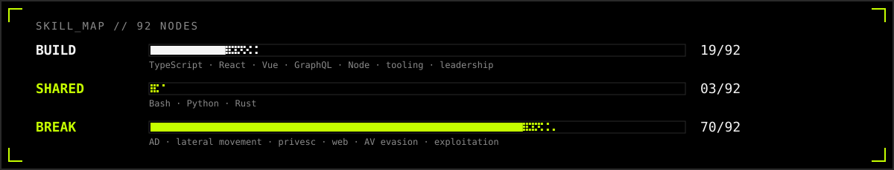

<a href="https://keegantech.dev">
  
</a>

### `01 // WHOAMI`

```
function    Technology Lead
station     Critical Mass
uptime      ~9 years agency-side
class       DEV // OFFSEC
cert        PEN-200 · MOD 27/28 · OSCP pending
pronouns    she/her
clearance   scoped only
org         @raven-workspace · owner
```

<a href="https://github.com/raven-workspace/raven">
  
</a>

[`> cd raven-workspace/raven`](https://github.com/raven-workspace/raven) · [`> view_dossier`](https://keegantech.dev/ops/raven)



### `02 // OPS`

| op | stack | status | |
|---|---|---|---|
| **RAVEN_WORKSPACE** | Tauri · Rust · React | `IN_DEV` | [`> view_dossier`](https://keegantech.dev/ops/raven) · [`> repo`](https://github.com/raven-workspace/raven) |
| **KEEGANTECH.DEV** | Astro · Cloudflare Workers | `V2_BUILD` | [`> view_dossier`](https://keegantech.dev/ops/keegantech-dev) |
| **RAVEN_DESKTOP** | Kali Linux | `RELEASED` | [`> view_dossier`](https://keegantech.dev/ops/raven-desktop) |
| **[REDACTED]** | 9 years of NDA enterprise web | `CLASSIFIED` | |

### `03 // FIELD_NOTES`

- `[PUBLISHED]` [HACKBOT 9000: The Truth About the AI Vulnpocalypse](https://keegantech.dev/notes/hackbot-9000)
- `[PUBLISHED]` [JWT Vulnerabilities — Sign Nothing, Be Anyone](https://keegantech.dev/notes/jwt-vulnerabilities)
- `[PUBLISHED]` [You'll Always Be Interesting to Me](https://keegantech.dev/notes/youll-always-be-interesting-to-me)

[`> cd ~/notes // open_archive`](https://keegantech.dev/notes)

### `04 // CTF`

```
CTF_01 is live. keegantech.dev is in scope.
Browser or curl only. No scanning, no brute force.
Hall of fame: empty.
```

[`> begin_challenge`](https://keegantech.dev/lost-and-found)

### `05 // CONTACT`

Open to frontend architecture, secure-by-default builds, and talks.

[`> EMAIL`](mailto:keegan@keegantech.dev) · [`[LINKEDIN]`](https://www.linkedin.com/in/ktechentin/) · [`[DOWNLOAD_CV]`](https://keegantech.dev/keegan-techentin-cv.pdf)

<sub>`NO TRACKERS · SERVED FROM THE EDGE.`</sub>
